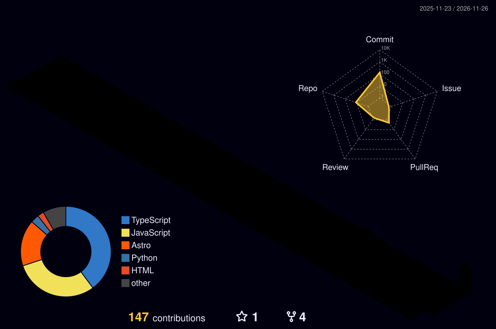

<!-- ===================== HEADER ===================== -->
<p align="center">
  
</p>

<p align="center">
  <a href="https://github.com/HNTRHACK">
    
  </a>
</p>

<p align="center">
  
  <a href="https://github.com/HNTRHACK?tab=followers"></a>
  
</p>

---

## 🧑‍💻 About Me

```ts
const hardik = {
  location:   "Mumbai, India 🇮🇳",
  role:       "Full-Stack Developer & AI Engineer",
  focus:      ["Full-Stack Development", "Generative AI", "Creative Frontend"],
  currently:  "Building AI-powered products that solve real problems",
  community:  "KJSSE Tech Community — Tech, PR & Operations",
  offline:    ["🏸 Competitive Badminton", "🎮 Valorant"],
  motto:      "Build. Break. Learn. Ship.",
};
```

---

## ⚡ Tech Stack

<p align="center">
  <b>Languages</b><br/><br/>
  
</p>

<p align="center">
  <b>Frontend</b><br/><br/>
  
</p>

<p align="center">
  <b>Backend & Databases</b><br/><br/>
  
</p>

<p align="center">
  <b>Tools</b><br/><br/>
  
</p>

<p align="center">
  
  
  
  
  
</p>

---

## 🚀 Featured Projects

<table>
  <tr>
    <td width="33%" valign="top">
      <h3>🌌 ORION</h3>
      <b>AI Traffic Forecasting System</b><br/><br/>
      Forecasts urban traffic congestion by fusing <b>GPS, traffic-sensor, weather and city-event data</b>.<br/><br/>
      
      
      
      
      
    </td>
    <td width="33%" valign="top">
      <h3>🧠 Mind Mates</h3>
      <b>AI-Powered Wellness Platform</b><br/><br/>
      Mood tracking, <b>AI emotional support</b> and personalized recommendations in one full-stack app.<br/><br/>
      
      
      
      
      
    </td>
    <td width="33%" valign="top">
      <h3>💧 HydroTrack</h3>
      <b>Smart Water Usage Monitor</b><br/><br/>
      A sustainability platform to <b>monitor and visualize water consumption</b> through an interactive UI.<br/><br/>
      
      
      
      
    </td>
  </tr>
</table>

---

## 🧊 3D Contribution Heatmap

<!-- Generated daily by .github/workflows/3d-contrib.yml -->
<p align="center">
  
</p>

---

## 📊 GitHub Stats

<p align="center">
  
  
</p>

<p align="center">
  
</p>

<p align="center">
  
</p>

---

## 🐍 Contribution Snake

<!-- Generated every 12h by .github/workflows/snake.yml into the `output` branch -->
<p align="center">
  <picture>
    <source media="(prefers-color-scheme: dark)" srcset="https://raw.githubusercontent.com/HNTRHACK/HNTRHACK/output/github-snake-dark.svg" />
    <source media="(prefers-color-scheme: light)" srcset="https://raw.githubusercontent.com/HNTRHACK/HNTRHACK/output/github-snake.svg" />
    
  </picture>
</p>

---

## 🏆 Beyond Code

| | |
|---|---|
| 💻 **KJSSE Tech Community** | Tech, PR & Operations |
| 🚀 **Hackathons & Technical Events** | Building and organizing |
| 🎨 **UI/UX** | Figma + creative frontend |
| 🏸 **Badminton** | Competitive player |
| 🎮 **Esports** | Valorant enthusiast |

---

## 📫 Let's Connect

<p align="center">
  <a href="https://github.com/HNTRHACK"></a>
  <a href="https://linkedin.com/in/hardik-bhatia"></a>
</p>

<!-- ===================== FOOTER ===================== -->
<p align="center">
  
</p>
